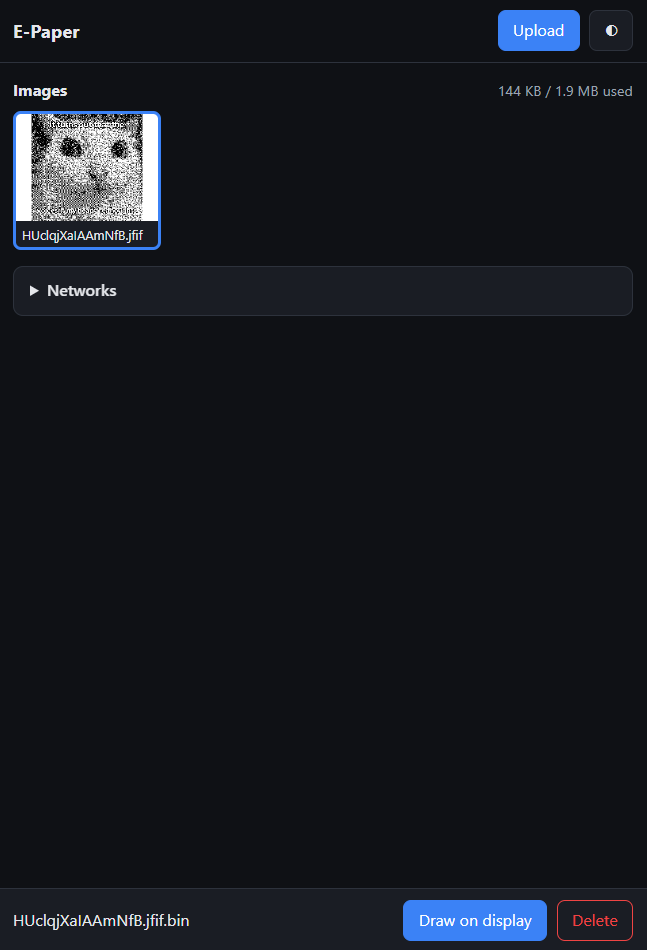
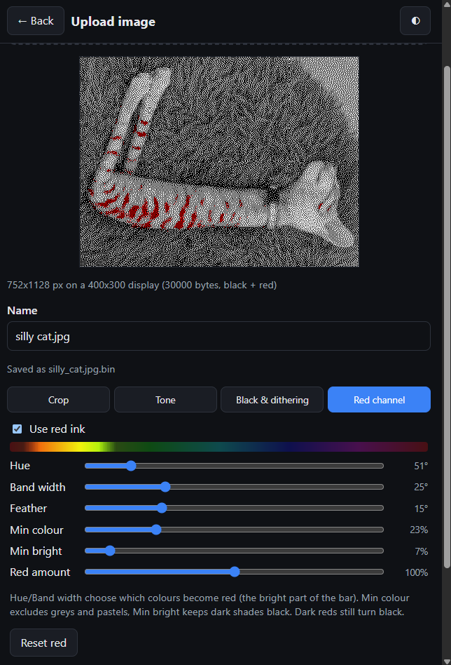

# E-Paper-Badge
This project is based on this [repo](https://github.com/atc1441/E-Paper_Pricetags/tree/main) by [atc1441](https://github.com/atc1441)

### Features:
- AP and WiFi support
- Easy to use ui
- Supports various image formats
- Croping, rotating, tone, dithering and red chanel controls with live preview during upload.
- Saves images to the onboard memory

### Images

### Parts list
- ESP32
- 4.4 inch BWR E-Paper pricetag
- 3D pritned case (TODO)
- 2x M3 heat insers and M3x16 bolts

### Instructions
1. Clone this repo and open it as a platformio project in VSCode.
2. Everything SHOULD be detected and downloaded automaticaly by pio.
3. Build and upload the project. Check the serial monitor for errors.
4. Connect to the access point and use the webui at http://192.168.100.183
5. Optionaly add your wifi network, to make the device automaticaly connect to it every time its turned on, to make it acessible to other devices on network. The ip on the network will be displayed